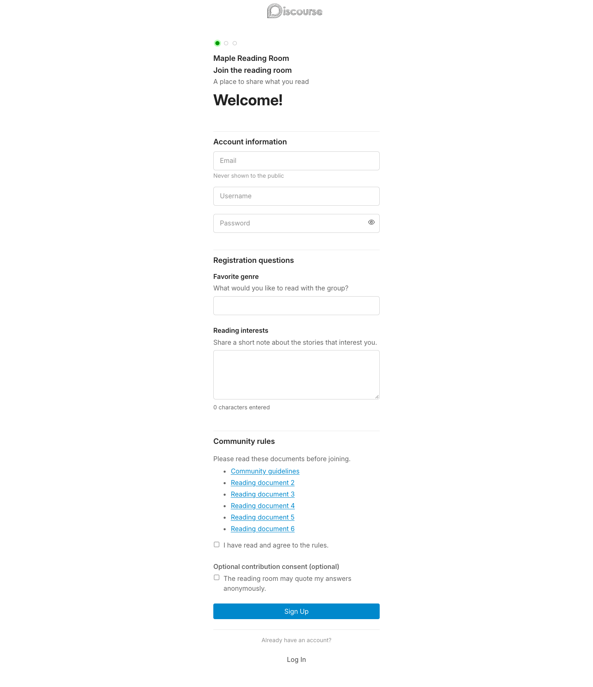

# Discourse Registration Enhancements

A free Discourse theme component for organizing registration fields and presenting community rules, with English and Simplified Chinese UI strings.

[简体中文](README.zh-CN.md) · [Configuration](docs/INSTALL.md) · [Upgrade and rollback](docs/MIGRATION.md) · [Compatibility](docs/COMPATIBILITY.md)

- Optional branding, section headings, field descriptions, character counts and progressive feedback.
- Ordered HTTPS rules links and a separate confirmation label attached to an existing native confirmation field.
- Native field requirements, account data and consent remain managed by Discourse. Standard installations need no plugin. Compatible validation plugins can supply additional server feedback.

[Mobile dark theme](docs/screenshots/registration-mobile-dark.png) · [Simplified Chinese UI](docs/screenshots/registration-zh-CN.png)

## Install

In **Admin → Appearance → Themes & components → Components → Install**, choose **From a git repository** and enter the [repository URL](https://github.com/Paotaro/discourse-registration-enhancements), or choose **From your device** and upload the [v2.0.0 component ZIP](https://github.com/Paotaro/discourse-registration-enhancements/releases/tag/v2.0.0). Attach it to the active themes used by signed-out visitors. These GitHub destinations become available after publication. [Official Discourse installation guide](https://meta.discourse.org/t/63682)

## Configure rules

Set `enable_rules` and select the existing registration confirmation field. Get its site-specific numeric ID from its edit address or record in **Admin → User fields**. DOM element IDs and `aria-describedby` are unsuitable. Set `rules_confirmation_field_id`, then configure `rules_intro`, `rules_confirmation_text` and ordered `rules_links` rows. Configure the field's required status in Discourse itself.

If the original checkbox description still appears and all custom rules text is missing, check the field ID, field type and active visitor theme. If only the links are missing, check each label and HTTPS address. [Full instructions](docs/INSTALL.md)

## Compatibility and contributing

Live tests covered the equivalent rc.4 runtime on Discourse `2026.12.0-latest` at commit `379e802dae213f2d6b293f4b74bbb6612528cbb0`, with standard Discourse and with the compatible validation plugin. The stable runtime matches rc.4. Email-code-only registration, other core releases and physical mobile devices were outside the live test scope. [Verification scope](TEST-REPORT.md)

MIT licensed. Contributions are welcome through issues and pull requests after publication. Include the Discourse version and synthetic reproduction steps. Run `node --test verification/registration.test.mjs` before submitting. [License](LICENSE) · [Third-party notices](THIRD-PARTY-NOTICES.md)
