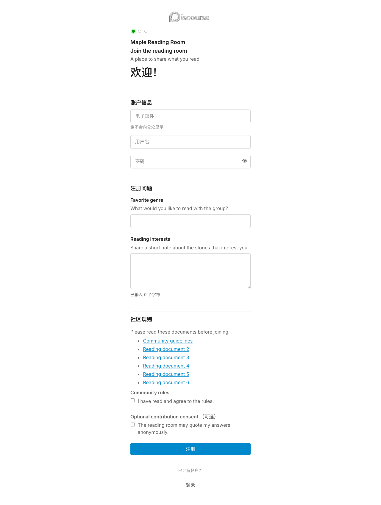

# Discourse Registration Enhancements

免费的 Discourse 注册主题组件，用于组织表单字段、展示社区规则，内置简体中文和英文界面。

[English](README.md) · [配置说明](docs/INSTALL.md) · [升级与回滚](docs/MIGRATION.md) · [兼容性](docs/COMPATIBILITY.md)

- 可配置品牌、分区、字段说明、字数统计和渐进式提示。
- 为现有原生确认字段设置有序 HTTPS 规则链接、阅读提示和独立确认文案。
- Discourse 继续管理字段约束、账号数据和授权记录。标准安装可独立使用，兼容验证插件可提供额外的服务端反馈。

[桌面浅色](docs/screenshots/registration-desktop.png) · [移动深色](docs/screenshots/registration-mobile-dark.png)

## 安装

在「管理后台 → 外观 → 主题与组件 → 组件 → 安装」选择从 Git 仓库安装并输入[仓库地址](https://github.com/Paotaro/discourse-registration-enhancements)，或选择从本机上传 [v2.0.0 组件 ZIP](https://github.com/Paotaro/discourse-registration-enhancements/releases/tag/v2.0.0)。把组件挂载到未登录访客使用的主题。GitHub 地址将在发布后生效。 [Discourse 官方安装指南](https://meta.discourse.org/t/63682)

## 配置规则

开启 `enable_rules`。从后台「用户字段」中现有注册确认字段的编辑地址或字段记录获取数字 ID，填入 `rules_confirmation_field_id`。ID 因站点而异，请勿从 DOM 元素 ID 或 `aria-describedby` 推断。分别设置 `rules_intro`、`rules_confirmation_text` 和有序的 `rules_links`。必选状态在原生用户字段中管理。

如果页面仍显示原生确认说明，且全部自定义内容未出现，检查字段 ID、类型和访客主题挂载。如果只有链接缺失，检查链接文字和 HTTPS 地址。 [完整配置说明](docs/INSTALL.md)

## 兼容性与贡献

实机验收使用与稳定版功能一致的 rc.4，覆盖目标提交 `379e802dae213f2d6b293f4b74bbb6612528cbb0` 的标准 Discourse 和兼容插件环境。仅邮箱验证码注册、其他核心版本和物理移动设备未纳入实机范围。 [验证范围](TEST-REPORT.md)

采用 MIT 许可证。发布后欢迎提交 Issue 或 Pull Request，请附 Discourse 版本和合成复现步骤，并先运行 `node --test verification/registration.test.mjs`。 [许可证](LICENSE) · [第三方声明](THIRD-PARTY-NOTICES.md)
